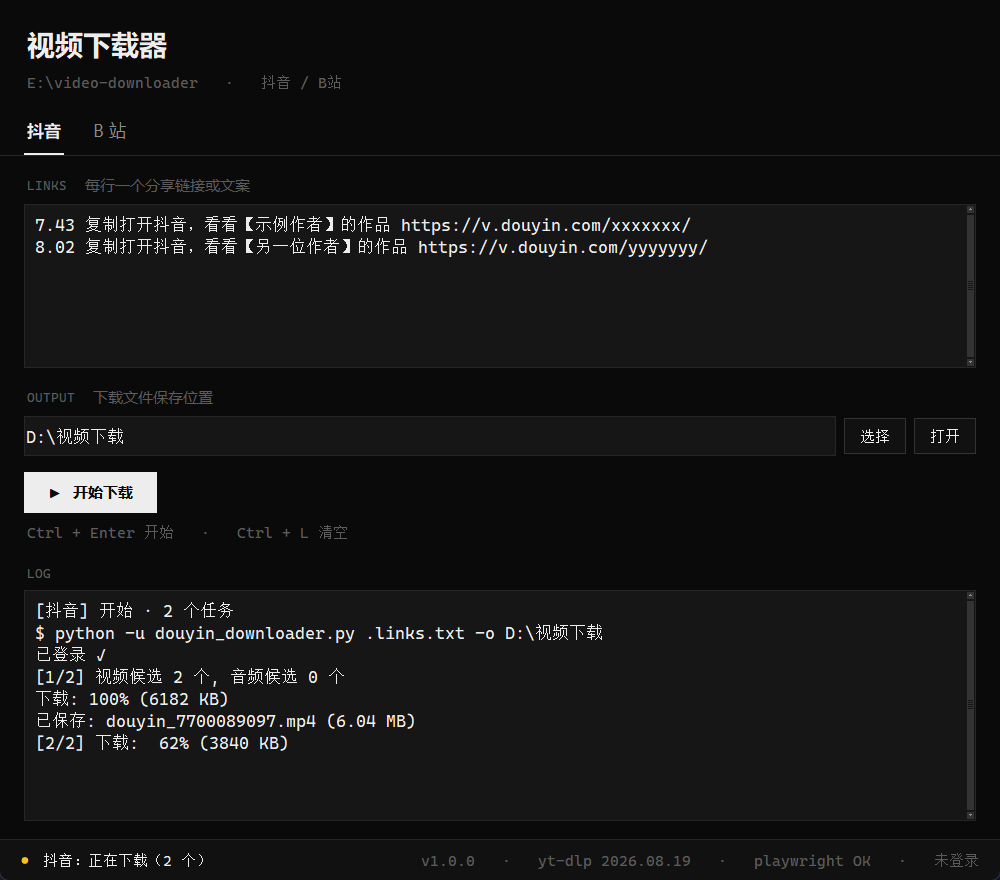
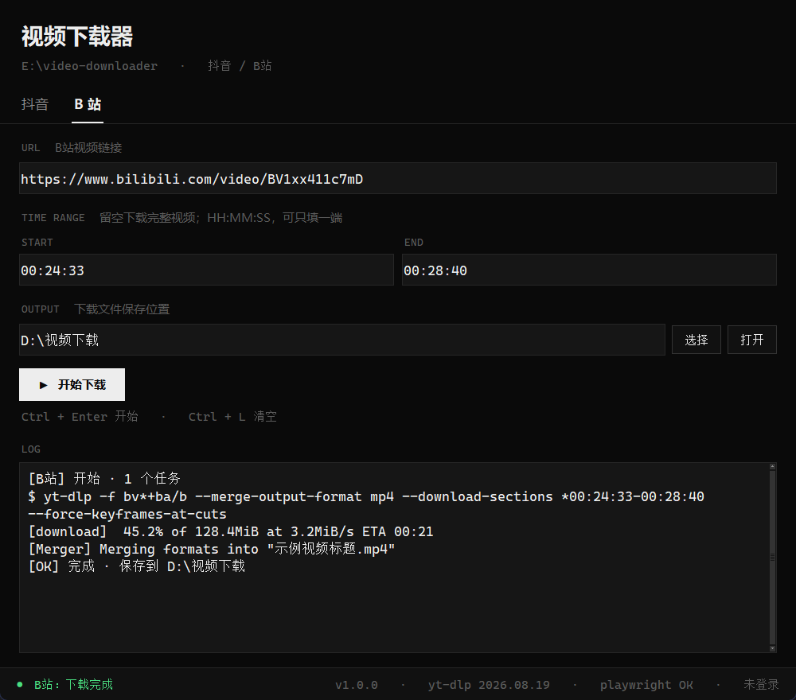

# 视频下载器

一个面向 Windows 的深色极简桌面工具，用于下载 **抖音** 与 **哔哩哔哩（B站）** 的视频。

抖音通过 Playwright 驱动本地 Chrome 直接抓取无水印源；B站通过调用第三方命令行工具 **yt-dlp** 下载，支持精确到秒的时间段裁剪。





---

## 目录

- [功能特性](#功能特性)
- [下载与安装](#下载与安装)
- [使用说明](#使用说明)
- [快捷键](#快捷键)
- [目录结构](#目录结构)
- [依赖与致谢](#依赖与致谢)
- [从源码运行](#从源码运行)
- [自己打包 EXE](#自己打包-exe)
- [更换图标](#更换图标)
- [隐私说明](#隐私说明)
- [常见问题](#常见问题)
- [许可协议](#许可协议)

---

## 功能特性

**抖音**

- 抓取无水印原始视频（非录屏、非二次转码）
- 批量下载：一行一个链接，也支持直接粘贴整段分享文案，自动提取其中的 URL
- 登录态本地持久化，扫码一次后续免登录

**B站**

- 下载完整视频，自动选择最佳画质并合并音视频为 MP4
- 时间段裁剪：只下载 `00:24:33` ~ `00:28:40` 这一段，支持只填开始或只填结束

**界面与体验**

- 深色等宽字体界面，实时滚动下载日志
- 底部状态栏显示任务状态，并自检运行环境（yt-dlp 版本 / Playwright 是否可用 / 抖音登录态）
- 键盘操作友好，`Ctrl + Enter` 直接开始

---

## 下载与安装

只提供 **Windows x64** 版本。

1. 打开本仓库的 [Releases](../../releases) 页面
2. 下载 `video-downloader-windows-x64-v1.0.0.zip`
3. 解压到任意目录（**不要在压缩包里直接双击运行**）
4. 双击 `视频下载器.exe`

无需安装 Python 或任何依赖，运行时已随包提供。

> ⚠️ **请勿单独移动 exe**。它需要同目录的 `python_full/` 和 `douyin_downloader.py` 才能工作。
> 想换位置就把整个文件夹一起移动或重新解压。

系统要求：Windows 10 / 11（64 位）。抖音下载需要在系统里装有 Google Chrome。

---

## 使用说明

### 抖音

1. 打开「抖音」标签页，把分享链接粘进 **LINKS** 框，**一行一个**。
   直接粘贴带中文的整段分享文案也可以，程序会自动挑出其中的 URL。
2. 选择保存位置（默认是系统下载目录）。
3. 点「开始下载」或按 `Ctrl + Enter`。

首次运行会自动打开浏览器窗口，请用抖音 App 扫码登录。登录状态保存在程序目录的 `.douyin_profile/` 里，之后不再需要扫码。

### B站

1. 打开「B 站」标签页，在 **URL** 里填入视频链接。
2. **TIME RANGE** 决定下载范围：
   - 两个都留空 → 下载完整视频
   - `00:24:33` ~ `00:28:40` → 只下载这一段
   - 只填开始 → 从该时间点到结尾
   - 只填结束 → 从开头到该时间点
3. 点「开始下载」。

时间段裁剪需要系统里有 **ffmpeg**（用于关键帧对齐）。没有 ffmpeg 时完整视频下载不受影响，但裁剪可能失败。

### 状态栏

界面最底部：

- 左侧圆点：灰=就绪、黄=进行中、绿=成功、红=失败
- 右侧环境自检：`v1.0.0 · yt-dlp 版本 · playwright 状态 · 抖音登录态`

下载过程中所有输出都会实时打印在 **LOG** 区域，出错时先看这里。

---

## 快捷键

| 按键 | 作用 |
| --- | --- |
| `Ctrl + Enter` | 开始下载当前标签页的任务 |
| `Ctrl + L` | 清空当前标签页的输入 |

---

## 目录结构

```
video-downloader/
├── video_downloader.py     图形界面（入口）
├── douyin_downloader.py    抖音下载引擎
├── make_icon.py            生成 icon.ico / icon.png
├── build_exe.py            打包成单文件 EXE
├── icon.ico                程序图标
├── icon.png                图标预览图
├── requirements.txt         源码运行所需依赖
├── docs/                   README 截图
├── LICENSE
└── THIRD_PARTY_NOTICES.md   第三方组件声明
```

运行时会自动生成：

```
├── .douyin_profile/        抖音登录态（仅本地，不会上传）
├── .links.txt              批量链接临时文件
└── build/                  build_exe.py 的中间产物
```

---

## 依赖与致谢

本项目**不包含**下列组件的源码，发布包中也只是原样打包它们的发行版本：

| 组件 | 作用 | 许可证 |
| --- | --- | --- |
| [yt-dlp](https://github.com/yt-dlp/yt-dlp) | **B站 下载的实际实现**。本项目仅通过命令行调用它，并拼接参数 | Unlicense |
| [Playwright](https://github.com/microsoft/playwright-python) | 驱动本地 Chrome 抓取抖音视频地址 | Apache-2.0 |
| [Python](https://www.python.org/) | 运行时 | PSF-2.0 |
| [Pillow](https://python-pillow.org/) | 仅 `make_icon.py` 生成图标时使用 | MIT-CMU |
| [FFmpeg](https://ffmpeg.org/) | 可选。B站 时间段裁剪与音视频合并 | LGPL-2.1+ / GPL-2.0+（取决于构建） |
| [PyInstaller](https://pyinstaller.org/) | 仅打包 EXE 时使用 | GPL-2.0-with-exception |

### 关于 B站 下载的说明

> **B站 的下载能力来自 yt-dlp，不是本项目实现的。**
> `video_downloader.py` 只负责界面交互与命令拼接，真正的解析、分片下载、合并都由 yt-dlp 完成。
> 遇到的问题若与 B站 解析有关（格式选择、登录校验、会员限制等），请优先查阅 [yt-dlp 的文档与 issue](https://github.com/yt-dlp/yt-dlp/issues)。
> 如果 yt-dlp 更新后接口有变化，本项目可能需要同步调整。

抖音部分的抓取逻辑写在 `douyin_downloader.py` 中，属于本项目自身代码。

---

## 从源码运行

需要 Python 3.9+：

```bash
pip install -r requirements.txt
playwright install chromium   # 可选，程序默认驱动系统已安装的 Chrome
python video_downloader.py
```

B站 下载还需要 yt-dlp 在 PATH 中可用：

```bash
pip install -U yt-dlp
```

---

## 自己打包 EXE

```bash
pip install pyinstaller
python build_exe.py
```

产物会输出到项目根目录的 `视频下载器.exe`。

注意：`build_exe.py` 打包出来的 exe **只是一个界面外壳**，运行时仍然依赖同目录下的 Python 运行时与 `douyin_downloader.py`。
如果你要制作可分发的压缩包，需要把这些一起带上（官方 Release 包里已经做好）。

---

## 更换图标

仓库自带的图标是脚本绘制的原创图形。想换成自己的图片：

```bash
python make_icon.py --src my_picture.jpg
python build_exe.py
```

图片建议用正方形、500px 以上。脚本会自动生成 256/128/64/48/32/16 多尺寸 ICO，小尺寸会收紧裁切并锐化处理，避免缩得太小糊掉。

---

## 隐私说明

- **登录态只存在本地**：抖音的登录信息保存在程序目录的 `.douyin_profile/`，不会上传到任何服务器。本项目不含任何统计、上报或远程接口。
- **不要分享这个目录**：`.douyin_profile/` 等同于你的抖音登录凭据。分发程序前请删除它。
- **下载内容只存在本地**：程序只会把视频写到你自己选择的目录。
- 程序运行时会访问抖音、B站 的公开页面，这部分网络行为与你在浏览器里访问这些网站一致。

---

## 常见问题

**双击 exe 没反应**

1. 确认 `python_full/` 和 exe 在同一个文件夹
2. 杀毒软件可能误报 PyInstaller 打包的程序，把它加入白名单
3. 若仍不行，用源码方式运行 `python video_downloader.py` 可以看到具体报错

**点下载没反应**

看 LOG 区域和状态栏。若提示「引擎解释器异常」或「找不到可执行文件」，说明运行时目录不完整，请重新完整解压。

**抖音一直提示未登录**

删除 `.douyin_profile/` 目录后重新运行，再扫一次码。

**抖音下载失败、浏览器一闪而过**

确认系统安装了 Google Chrome，并尝试手动打开一次抖音网页确认能正常访问。

**B站 下载失败**

先看 LOG 里 yt-dlp 的原始报错。部分视频需要登录态，可以在命令行手动验证：

```bash
yt-dlp --cookies-from-browser chrome "视频链接"
```

**B站 裁剪失败**

安装 ffmpeg 并确保它在 PATH 中；或先不填时间段，确认完整下载正常。

---

## 免责声明

本工具仅供个人学习与技术研究使用。请遵守抖音、哔哩哔哩的服务条款与相关法律法规，不要用于批量抓取、二次分发或任何侵犯他人权益的用途。下载内容的版权归原作者所有。

---

## 许可协议

本项目自身代码采用 [MIT License](LICENSE) 发布。

第三方组件遵循各自许可证，详见 [THIRD_PARTY_NOTICES.md](THIRD_PARTY_NOTICES.md)。
